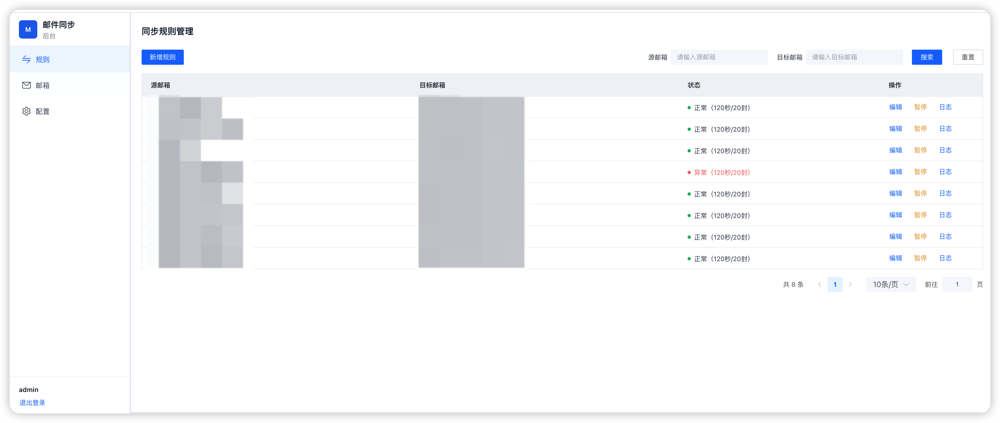
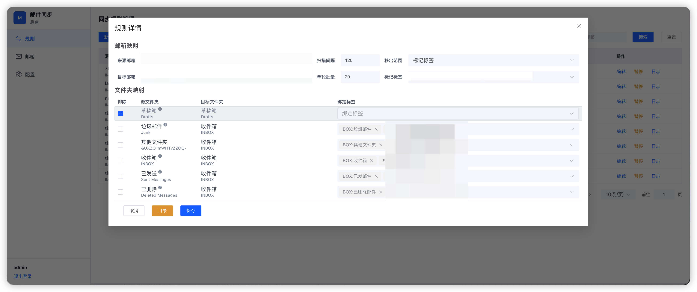
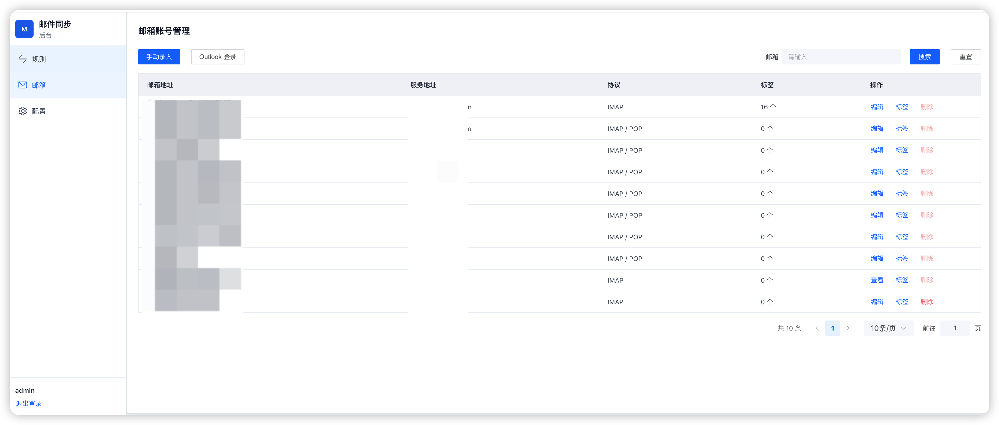
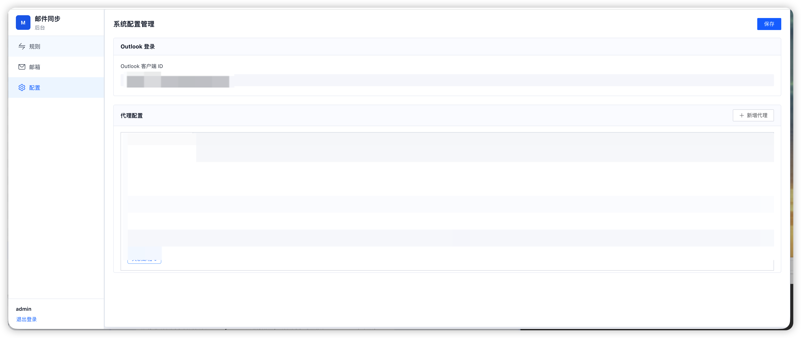
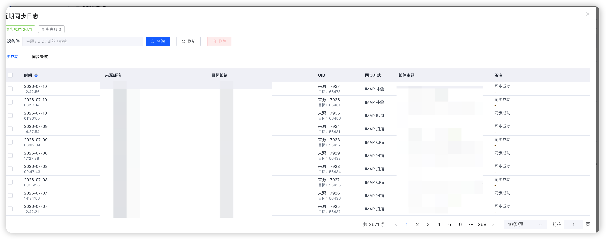

# Mail Sync

Mail Sync 是一个面向个人或小团队的邮件同步工具，用于把多个来源邮箱中的邮件统一同步到一个目标邮箱，并通过 Synology MailPlus 标签保留来源账号和来源文件夹信息。

Mail Sync is a mail synchronization tool for individuals and small teams. It syncs messages from multiple source mailboxes into one target mailbox while preserving source account and source folder context with Synology MailPlus labels.

## 功能 / Features

- 多来源邮箱同步到单一目标邮箱
- 来源 UID、`Message-ID`、内容哈希去重
- 来源文件夹变化、删除对账和崩溃恢复
- IMAP IDLE 准实时监听，必要时退回轮询
- Outlook.com / Microsoft 365 OAuth2 登录
- HTTP CONNECT 代理配置
- Web 管理控制台维护邮箱、规则、标签和连接测试

- Sync multiple source mailboxes into one target mailbox
- Deduplicate by source UID, `Message-ID`, and content hash
- Reconcile moved/deleted source messages and recover interrupted writes
- Use IMAP IDLE for near real-time updates, with polling fallback
- Support Outlook.com / Microsoft 365 OAuth2 authentication
- Support HTTP CONNECT proxy settings
- Manage mailboxes, rules, labels, and connection tests from a built-in web console

## 界面截图 / Screenshots

以下截图使用脱敏数据展示主要管理页面。

The screenshots below use redacted data and show the main admin views.

### 同步规则 / Sync Rules



### 规则详情 / Rule Details



### 邮箱管理 / Mailboxes



### 系统配置 / System Configuration



### 同步日志 / Sync Logs



## 目录 / Project Layout

```text
backend/   Python backend, CLI, Web API, tests, and legacy JSON config template
frontend/  Vue 3 admin console source
deploy/    Dockerfile, Compose, and deployment scripts
docs/      Sync rules and architecture notes
data/      Local runtime data, ignored by git
logs/      Local logs, ignored by git
```

## 快速开始 / Quick Start

启动 Web 管理控制台：

Start the web admin console:

```bash
python3 backend/mail_sync.py serve --host 127.0.0.1 --port 24000
```

首次初始化数据库时会创建管理员用户。推荐在第一次启动前显式设置管理员密码：

The first database initialization creates an admin user. Set the initial admin password before first startup:

```bash
export MAIL_SYNC_ADMIN_PASSWORD='change-this-password'
```

如果没有设置 `MAIL_SYNC_ADMIN_PASSWORD`，程序会生成随机初始密码并写入状态库同目录的 `initial-admin-password.txt`。该文件权限为 `0600`，登录并设置永久密码后应删除。

If `MAIL_SYNC_ADMIN_PASSWORD` is not set, the app generates a random initial password and writes it to `initial-admin-password.txt` next to the state database. The file is created with `0600` permissions and should be deleted after you sign in and set a permanent password.

导入旧 JSON 配置：

Import a legacy JSON configuration:

```bash
python3 backend/mail_sync.py import-config backend/config/config.json
```

列出来源文件夹：

List source folders:

```bash
python3 backend/mail_sync.py list-folders --source source@example.com
```

执行同步：

Run a sync:

```bash
python3 backend/mail_sync.py sync
```

常驻监听：

Run the watcher:

```bash
python3 backend/mail_sync.py watch
```

更完整的同步规则和 Outlook OAuth 配置见 [docs/SYNC_RULES.md](docs/SYNC_RULES.md)。

For detailed sync rules and Outlook OAuth setup, see [docs/SYNC_RULES.md](docs/SYNC_RULES.md).

## 前端开发 / Frontend Development

先启动后端：

Start the backend first:

```bash
python3 backend/mail_sync.py serve --host 127.0.0.1 --port 24000
```

再启动 Vite：

Then start Vite:

```bash
cd frontend
npm install
npm run dev
```

构建生产前端产物：

Build production frontend assets:

```bash
cd frontend
npm run build
```

## Docker

构建并启动：

Build and start:

```bash
docker compose -f deploy/compose.yaml up -d --build
```

查看应用日志：

View application logs:

```bash
tail -f logs/web.log
tail -f logs/sync.log
```

推荐使用带一致性备份、健康验证和失败回滚的重部署脚本：

For deployments, prefer the script with a consistent SQLite backup, health
verification, and automatic image rollback:

```bash
./deploy/redeploy.sh
```

部署备份保存在 `data/backups/`，默认保留最近 10 份。服务提供无需登录且不泄露
邮箱详情的健康检查接口：

Deployment backups are stored in `data/backups/` with the latest 10 retained
by default. The service exposes unauthenticated liveness and business-health
endpoints without mailbox details:

```bash
curl http://127.0.0.1:24000/api/live
curl http://127.0.0.1:24000/api/health
```

`/api/live` 只检查 Web、SQLite 和同步进程心跳，供 Docker 与部署验证使用；
`/api/health` 还会检查规则失败和待恢复操作，适合监控告警。

常用运行参数：

- `MAIL_SYNC_COOKIE_SECURE=1`：通过 HTTPS 反向代理部署时使用安全 Cookie。
- `MAIL_SYNC_TRUST_PROXY=1`：允许可信反向代理提供客户端地址，用于登录限流。
- `MAIL_SYNC_TRUSTED_PROXY_CIDRS=127.0.0.0/8,::1/128`：允许解析转发头的代理来源网段。
- `MAIL_SYNC_HEARTBEAT_INTERVAL_SECONDS=30`：同步主循环心跳写入间隔。
- `MAIL_SYNC_HEARTBEAT_MAX_AGE_SECONDS=600`：同步主循环最大允许无心跳时间。
- `MAIL_SYNC_LOG_MAX_BYTES=20971520`：单个应用日志的轮转阈值。
- `MAIL_SYNC_LOG_BACKUP_COUNT=10`：每个应用日志保留的轮转文件数。
- `MAIL_SYNC_DEPLOY_BACKUP_KEEP=10`：重部署前一致性数据库备份的保留数量。

如果部署环境需要把某个 IMAP 域名映射到内网地址，可通过环境变量覆盖：

If your deployment needs to map an IMAP hostname to an internal address, override it with an environment variable:

```bash
MAIL_SYNC_EXTRA_HOST='imap.example.internal:127.0.0.1' \
docker compose -f deploy/compose.yaml up -d --build
```

## 安全说明 / Security Notes

不要提交以下运行数据：

Do not commit runtime data such as:

- `backend/config/config.json`
- `data/`
- `logs/`
- `initial-admin-password.txt`
- OAuth token files
- SQLite state databases and their `-wal`, `-shm`, `.lock` sidecars

这些路径已经在 `.gitignore` / `.dockerignore` 中排除。公开发布前仍建议运行一次敏感信息扫描，确认示例配置、文档和部署参数没有真实邮箱、token、内网 IP 或密码。

These paths are excluded by `.gitignore` / `.dockerignore`. Before publishing the repository, run a secret scan and confirm that examples, docs, and deployment settings do not contain real mailboxes, tokens, private IPs, or passwords.

## 测试 / Tests

从 `backend/` 目录运行后端测试：

Run backend tests from `backend/`:

```bash
cd backend
python3 -m unittest
```

也可以运行指定测试文件：

You can also run selected test modules:

```bash
cd backend
python3 -m unittest tests.test_sync_state tests.test_oauth_config
```

## License

Apache License 2.0. See [LICENSE](LICENSE).
